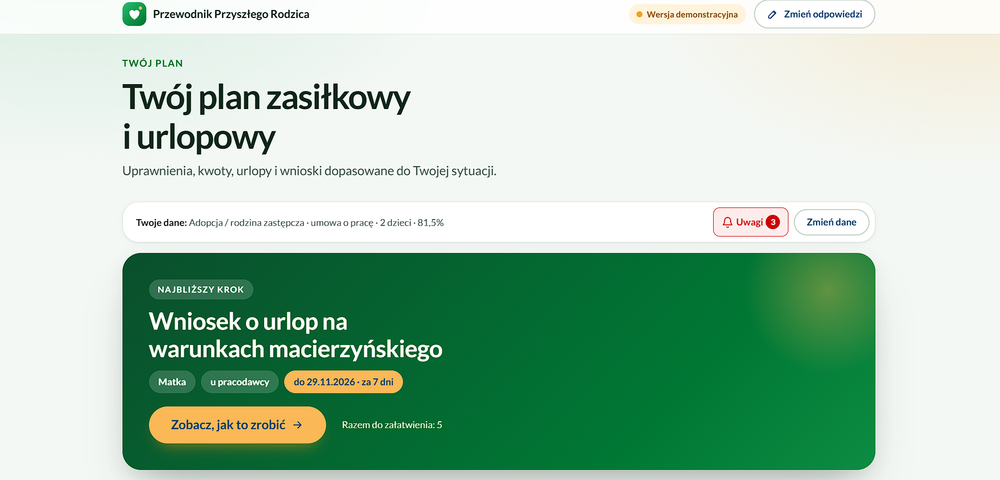
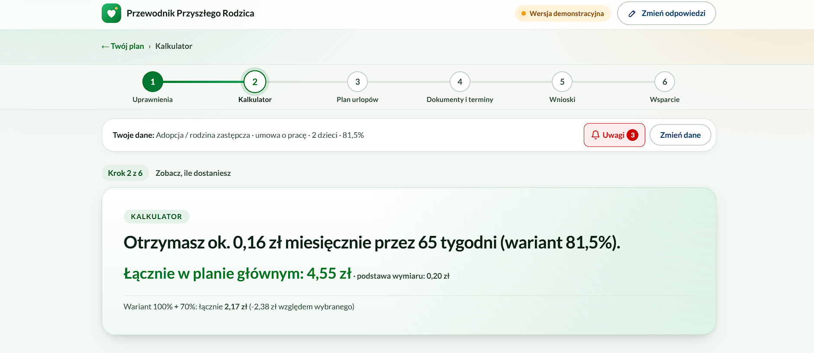
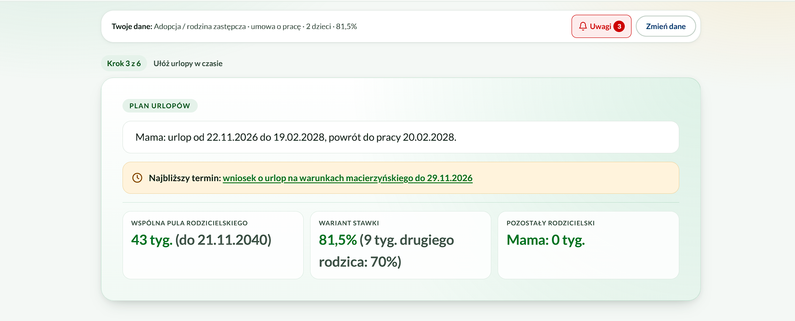
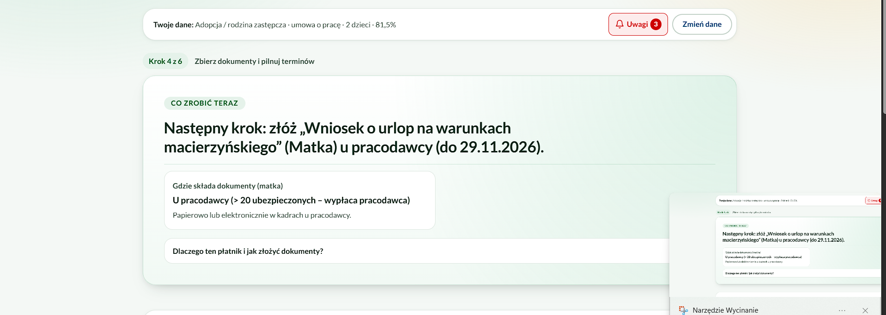
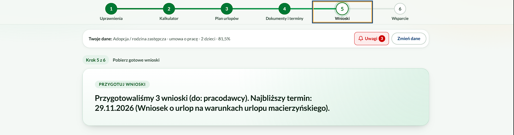
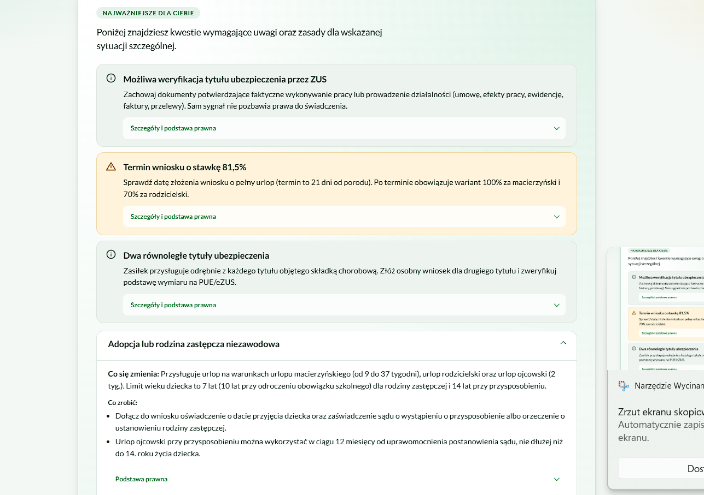
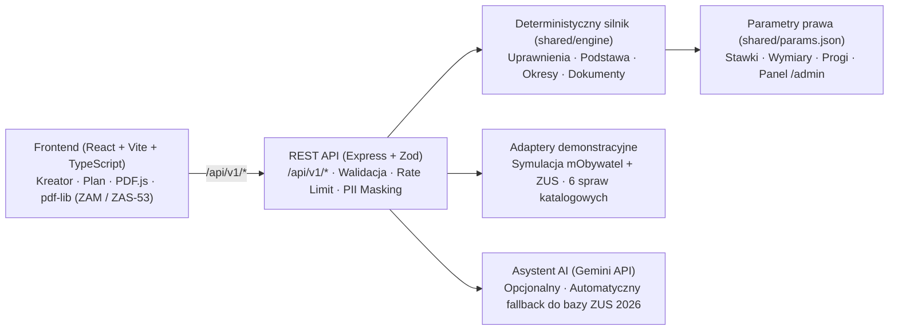

<div align="center">

# Zasiłkowy Przewodnik Przyszłego Rodzica

**Prosty plan urlopów, świadczeń i formalności ZUS — od ciąży i porodu po adopcję i trudne sytuacje życiowe.**

Projekt zespołowy przygotowany na **HackNation 2026** dla wyzwania Zakładu Ubezpieczeń Społecznych.

[](https://github.com/bchochoool/Hacknation_2026/actions/workflows/ci.yml)


</div>

---

## O co chodzi w projekcie?

Przepisy wokół zasiłku macierzyńskiego, urlopu rodzicielskiego i zwolnień w ciąży potrafią przytłoczyć — szczególnie wtedy, gdy w życiu rodziny dzieje się najważniejsza rzecz. Rodzice często nie wiedzą:
- czy przysługuje im zasiłek i kto go wypłaca (**pracodawca** czy **ZUS**),
- czy wybrać **81,5% przez cały rok**, czy **100% + 70%**, i kiedy mija kluczowy termin **21 dni od porodu**,
- co grozi przy działalności gospodarczej (**dług powyżej 1% płacy minimalnej blokuje wypłatę**), przy kończącej się umowie na czas określony albo przy dwóch tytułach ubezpieczenia,
- jakie dokumenty złożyć, do kogo i w jakiej kolejności.

**ZUS Przewodnik** zamienia zawiłe przepisy w **jeden spójny, spersonalizowany plan** ułożony ludzkim językiem. Najpierw odpowiada na najważniejsze pytanie (*„co mi przysługuje i ile dostanę?”*), a dopiero później rozwija szczegóły, podstawy prawne i gotowe wnioski.

> [!NOTE]
> Aplikacja jest prototypem demonstracyjnym. Logowanie przez **mObywatela**, dane z **ZUS** (w tym e-ZLA i zaświadczenie o zadłużeniu) oraz wysyłka wniosków działają w trybie symulacji na fikcyjnych profilach. Wyliczenia mają charakter informacyjny i nie zastępują oficjalnej decyzji ZUS.

---

## Podgląd aplikacji

| Twój plan zasiłkowy i urlopowy | Kalkulator zasiłków (81,5% vs 100% + 70%) |
| :---: | :---: |
|  |  |

| Plan urlopów i podział między rodziców | Dokumenty, terminy i lista zadań |
| :---: | :---: |
|  |  |

| Gotowe wnioski i formularze PDF | Wsparcie i Asystent AI |
| :---: | :---: |
|  |  |

<details>
<summary><strong>Zobacz wszystkie zrzuty ekranu (15 widoków)</strong></summary>

- **Kalkulator:** [`Kalkulator2.png`](docs/screens/Kalkulator2.png) · [`Kalkulator3.png`](docs/screens/Kalkulator3.png)
- **Plan urlopów:** [`Urlop2.png`](docs/screens/Urlop2.png) · [`Urlop3.png`](docs/screens/Urlop3.png)
- **Dokumenty i terminy:** [`Dokumenty2.png`](docs/screens/Dokumenty2.png) · [`Dokumenty3.png`](docs/screens/Dokumenty3.png)
- **Wnioski PDF:** [`Wnioski2.png`](docs/screens/Wnioski2.png) · [`Wnioski3.png`](docs/screens/Wnioski3.png)
- **Wsparcie:** [`Wsparcie2.png`](docs/screens/Wsparcie2.png)

</details>

---

## Dlaczego rozwiązanie jest gotowe do wdrożenia w ZUS?

| Filar | Jak to rozwiązaliśmy |
| --- | --- |
| **Determinizm — zero halucynacji AI przy kwotach** | Cała logika uprawnień, podstaw wymiaru, okresów, stawek i terminów działa w czystym, deterministycznym silniku TypeScript (`shared/engine/`), pokrytym testami jednostkowymi i sprawami katalogowymi. Model AI pełni wyłącznie rolę asystenta wyjaśniającego w zakładce **Wsparcie**. |
| **Parametryzacja bez zmian w kodzie** | Stawki, wymiary urlopów, płaca minimalna i progi prawne znajdują się w jednym pliku [`shared/params.json`](zus-przewodnik-starter/shared/params.json) i mogą być aktualizowane w panelu [`/admin`](http://localhost:5173/admin) — np. przy corocznej zmianie płacy minimalnej. |
| **Prywatność i RODO by design** | Dane wrażliwe (PESEL, numery rachunków bankowych) nigdy nie trafiają do `localStorage`/`sessionStorage`, są maskowane przed wysłaniem pytania do AI, a import i generowanie PDF (`ZAM`, `ZAS-53`) odbywa się w całości lokalnie w przeglądarce. |
| **Dostępność (WCAG 2.1 AA) i empatyczny UX** | Interfejs mobile-first (czytelny od 360 px), wysokie kontrasty, nawigacja klawiaturą i link „Przejdź do treści”, lokalne fonty Lato oraz spokojny, empatyczny język w sytuacjach trudnych (wcześniactwo, hospitalizacja, utrata dziecka, „Za życiem”). |

---

## Jak działa krok po kroku?

```text
1. Wybór sytuacji          2. Dane (ręcznie lub mObywatel)     3. Twój spersonalizowany plan
   Ciąża · Po porodzie  ─►    Prosty kreator krok po kroku  ─►    Uprawnienia · Kalkulator · Urlopy
   Planowanie · Adopcja       albo gotowe profile testowe         Dokumenty · Wnioski PDF · Asystent AI
```

### Co znajdziesz w aplikacji?

| Moduł | Co daje użytkownikowi |
| --- | --- |
| **Kreator sytuacji** (`/wizard`) | Zbiera tylko te informacje, które faktycznie wpływają na uprawnienia i kwoty — bez żargonu, z obsługą m.in. JDG, umowy zlecenia, drugiego tytułu ubezpieczenia, wcześniaków i trudnych sytuacji życiowych (ze spokojnym, empatycznym tonem). |
| **Symulacja mObywatela i ZUS** (`/login`) | Pozwala zalogować się na fikcyjny profil demonstracyjny (**Anna Testowa**, **Jan Testowy**), automatycznie uzupełnić puste pola w formularzu z oznaczeniem źródła danych oraz wyświetlić panel danych ubezpieczeniowych, **e-ZLA z kodem „B”** i **zaświadczenia o zadłużeniu składkowym**. |
| **Twój plan** (`/plan`) | Sześć czytelnych zakładek w jednym miejscu: **Uprawnienia** (ze zwijanymi szczegółami świadczeń), **Kalkulator** (porównanie 81,5% vs 100% + 70%), **Plan urlopów** (oś czasu mamy i taty, presety podziału, kalendarz i łączenie urlopu z pracą), **Dokumenty i terminy**, **Wnioski** (podgląd, mapa składania i generator wypełnionych PDF-ów **ZAM** / **ZAS-53**) oraz **Wsparcie**. |
| **Centrum powiadomień „Uwagi”** | Wspólny przycisk z licznikiem w górnym pasku planu zbiera w jednym miejscu wszystkie ryzyka i kluczowe terminy (np. zadłużenie JDG, termin 21 dni, okres wyczekiwania), żeby nie dublować ostrzeżeń między zakładkami. |
| **Asystent AI w zakładce Wsparcie** | Odpowiada na pytania w kontekście zanonimizowanego planu użytkownika (Google Gemini `gemini-3.1-flash-lite`), maskuje wrażliwe dane (PESEL, numer konta), blokuje wklejanie zdjęć, chroni limity cache'em i rate limiterem, a bez klucza API płynnie przechodzi na lokalną bazę ZUS 2026. |
| **Przykładowe sprawy i import PDF** (`/cases`) | Katalog 6 spraw testowych do natychmiastowego sprawdzenia działania silnika oraz lokalny odczyt pól z własnego pliku PDF w przeglądarce (z weryfikacją przez użytkownika przed przeliczeniem). |
| **Przewodnik i Panel parametrów** (`/guide`, `/admin`) | Baza wiedzy po ludzku oraz panel demonstracyjny do podglądu i zmiany aktualnych stawek i progów (np. płacy minimalnej). |

---

## Architektura systemu



---

## Szybki start

Wymagania: **Node.js 20.12+** oraz **npm 10+**.

```bash
cd zus-przewodnik-starter
npm ci
npm run dev
```

Po uruchomieniu:
- **Aplikacja (frontend):** [`http://localhost:5173`](http://localhost:5173/)
- **API (healthcheck):** [`http://localhost:3001/api/v1/health`](http://localhost:3001/api/v1/health) — powinno zwrócić `{"data":{"status":"ok"},"error":null}`

> [!TIP]
> **Asystent AI działa od razu nawet bez konfiguracji** (w lokalnym trybie bazy ZUS 2026). Jeśli chcesz włączyć odpowiedzi na żywo z Google Gemini, skopiuj [`zus-przewodnik-starter/.env.example`](zus-przewodnik-starter/.env.example) do `zus-przewodnik-starter/.env` i wpisz swój `GEMINI_API_KEY`. Plik `.env` jest ignorowany przez Git.

---

## Jak przetestować aplikację w 2 minuty?

### Ścieżka 1 — najszybsza (1 kliknięcie)
1. Otwórz [**Przykładowe sprawy**](http://localhost:5173/cases), wybierz np. **sprawę 04** i kliknij **„Otwórz w planie”** — zobaczysz od razu uprawnienia, kalkulator, oś czasu obojga rodziców, powiadomienia **Uwagi**, dokumenty i wnioski PDF.
2. Możesz też wejść w [**Logowanie (mObywatel – symulacja)**](http://localhost:5173/login), wybrać profil **Anna Testowa** lub **Jan Testowy** i przejść do kreatora z automatycznym oznaczeniem źródeł danych oraz panelem symulacji ZUS.

### Ścieżka 2 — pełny test ręczny z fikcyjną rodziną

<details>
<summary><strong>Rozwiń scenariusz testowy: Anna i Piotr Kowalscy (spodziewają się dziecka)</strong></summary>

Wybierz na stronie startowej: **Jestem w ciąży → Kontynuuj bez logowania → Dwoje rodziców**.

| Krok w kreatorze | Dane do wpisania |
| --- | --- |
| Przewidywany termin porodu i liczba dzieci | Data ok. **8 tygodni od dziś**, **1 dziecko** |
| Zaświadczenie „Za życiem” i sytuacja mamy | **Nie** oraz **Nie dotyczy** |
| Zatrudnienie obojga | **Umowa o pracę**. Ubezpieczenie Anny od `01.03.2022`, Piotra od `01.06.2021`. Dla obojga wybierz umowę bezterminową. |
| Liczba osób zgłoszonych przez płatników | Pracodawca Anny: **80**, pracodawca Piotra: **15** |
| Dodatkowe pytania o Annę | Wiek **30 lat**, rozwiązanie umowy: **Nie**, zwolnienie w tej ciąży: **Nie** |
| Urlop i zarobki | Oboje planują skorzystać. Wybierz **„Podstawę ustalimy później”** i wpisz po **7 000 zł** brutto dla Anny oraz **8 500 zł** brutto dla Piotra. |
| Drugi tytuł i wariant zasiłku | **Nie, mam tylko jeden tytuł** oraz **Jeszcze nie wiemy – pokażcie porównanie** |

Kliknij **Zapisz odpowiedzi → Przejdź do planu → Kalkulator**.
- Podstawy wymiaru powinny wynieść **6 040,30 zł** dla Anny (wypłaca pracodawca) i **7 334,65 zł** dla Piotra (wypłaca ZUS).
- Porównaj oba warianty wypłaty (**81,5%** vs **100% + 70%**) i sprawdź podział urlopów na osi czasu w zakładce **Plan urlopów**.

</details>

---

## Testy, audyt i weryfikacja

Wszystkie polecenia wykonuj w katalogu `zus-przewodnik-starter`:

```bash
npm run lint       # ESLint dla całego monorepo
npm run typecheck  # TypeScript (shared, server, client)
npm test           # Testy jednostkowe i integracyjne Vitest (shared, server, client)
npm run build      # Pełny build produkcyjny
```

W repozytorium znajduje się także automatyczny workflow [GitHub Actions CI](.github/workflows/ci.yml), który weryfikuje powyższy zestaw przy każdym `push` i `pull_request` do `main`.

### Znane ograniczenia prototypu i dalszy rozwój
- Symulacja mObywatela, danych ZUS i wysyłki PUE/eZUS wymagałaby docelowo podpięcia rzeczywistych interfejsów uwierzytelniania i integracji ZUS.
- Silnik zawiera testy regresyjne **AUD-01–AUD-24** (24 ustalenia z audytu prawno-technicznego rozwiązane w `main`) oraz progi historyczne dla lat 2025–2026; pełna analiza przypadków brzegowych i dokumentacja rozbieżności (m.in. `case-05`) znajduje się w **[audycie reguł ZUS i macierzy testowej](docs/test-cases.md)**.

---

## Zakres wykorzystania sztucznej inteligencji (AI)

Zgodnie z wymaganiami zadania konkursowego (§ 4 i § 9 treści wyzwania) poniżej jasno wskazujemy zakres użycia mechanizmów AI:

- **W działaniu aplikacji:** sztuczna inteligencja jest wykorzystywana **wyłącznie** w opcjonalnym **Asystencie AI** w zakładce **Wsparcie** (`POST /api/v1/assistant/ask`, Google Gemini `gemini-3.1-flash-lite`). Funkcja jest jawnie oznaczona w interfejsie komponentem `<AiBadge />`, maskuje dane wrażliwe (PESEL, numery kont) przed wysłaniem zapytania, a bez klucza API automatycznie przechodzi w deterministyczny tryb lokalnej bazy ZUS 2026 (`is_demo_fallback: true`). **Kalkulator, ustalanie uprawnień, terminy, plan urlopów, odczyt pól PDF (`PDF.js`) i generowanie wniosków (`pdf-lib`) nie wykorzystują AI** — działają w 100% deterministycznie.
- **W procesie twórczym:** narzędzia AI wspierały zespół podczas programowania, pisania testów jednostkowych/regresyjnych oraz porządkowania dokumentacji na podstawie wspólnego kontraktu ([`agents/CONVENTIONS.md`](zus-przewodnik-starter/agents/CONVENTIONS.md)), przy pełnej weryfikacji merytorycznej i audycie zgodności z przepisami ZUS 2026.

---

## Zgodność z wymaganiami zadania ZUS

| Wymaganie z treści wyzwania (§ 3 i § 5) | Realizacja w aplikacji |
| --- | --- |
| Świadczenia w ciąży (chorobowy, zasiłek w wysokości macierzyńskiego, brak uprawnień) | Kreator `/wizard` + zakładka **Uprawnienia** i **Kalkulator** (`/plan/entitlements`, `/plan/calculator`) |
| Zintegrowany kalkulator dla obojga rodziców, łączenie pracy z rodzicielskim, adopcja i rodzina zastępcza, indywidualna podstawa | Jeden spójny kalkulator + **Plan urlopów** (`/plan/leave-plan`) z osią czasu, podziałem części, pracą na część etatu i adopcją |
| Dokumenty, terminy, płatnik vs ZUS, zagrożenia i ryzyka | Zakładka **Dokumenty i terminy**, centrum powiadomień **Uwagi**, mapa składania i ostrzeżenia o ryzykach (m.in. dług JDG art. 2a, pozorność, podwyższenie podstawy) |
| Symulacje: mObywatel, dane ZUS, zadłużenie JDG, e-ZLA, PUE/eZUS, wnioski + akt urodzenia USC | `/login` (symulacja mObywatela i paneli ZUS), `/plan/applications` (wnioski ZAM, ZAS-53, wniosek USC, symulacja wysyłki), `/plan/support` (symulacja PUE/eZUS) |
| Organizacje charytatywne i oficjalne linki (ZUS, MRPiPS, PIP, USC) | Zakładka **Wsparcie** (`/plan/support`) i **Przewodnik** (`/guide`) |
| Testowanie przykładowych spraw i upload własnego PDF | Katalog spraw i lokalny import PDF w `/cases` |
| Panel administracyjny parametrów (zmiany legislacyjne) | `/admin` + centralny plik [`shared/params.json`](zus-przewodnik-starter/shared/params.json) |
| Preferowany stack techniczny (React, JavaScript/TypeScript, REST API, RWD) | React + Vite + TypeScript + Express REST API (`/api/v1/*`), RWD od 360 px (WCAG 2.1 AA) |

> [!IMPORTANT]
> **Ochrona materiałów konkursowych:** zgodnie z zastrzeżeniem ZUS żadne oryginalne dokumenty źródłowe ani załączniki udostępnione uczestnikom HackNation 2026 nie zostały skopiowane ani umieszczone w tym repozytorium (katalogi robocze `docs/zus/` i `data/cases-raw/` są wykluczone w `.gitignore`).

---

## Struktura repozytorium

```text
Hacknation_2026/
├── .github/
│   ├── workflows/ci.yml           # Automatyczny pipeline CI (lint, typecheck, test, build)
│   ├── CODEOWNERS                 # Opiekunowie obszarów projektu
│   └── pull_request_template.md   # Szablon Pull Requesta
├── zus-przewodnik-starter/        # Kod źródłowy aplikacji (monorepo npm workspaces)
│   ├── client/                    # Frontend React + Vite + TypeScript (kreator, plan, PDF, AI UI)
│   ├── server/                    # REST API Express + walidacja Zod + adaptery (mObywatel, ZUS, Gemini)
│   ├── shared/                    # Deterministyczny silnik uprawnień, kwot, okresów i dokumentów
│   ├── data/                      # Zanonimizowane sprawy katalogowe (cases/) i fikcyjne profile (profiles/)
│   ├── agents/                    # Kontrakt API i wytyczne pracy zespołu
│   └── README.md                  # Szczegółowa dokumentacja techniczna, zmienne .env i mapa modułów
├── docs/                          # Dokumentacja jakościowa, audyt i zrzuty ekranu
│   ├── screens/                   # Zrzuty ekranu kluczowych widoków aplikacji
│   ├── test-cases.md              # Audyt reguł ZUS i macierz przypadków testowych
│   └── FIX_ALL_REPORT.md          # Historia integracji modułów
└── README.md                      # Ten plik
```

Szczegółową konfigurację środowiska (zmienne `.env`, własne porty, opis endpointów API, zależności, rozwiązania zewnętrzne i weryfikację E2E) znajdziesz w **[dokumentacji technicznej aplikacji](zus-przewodnik-starter/README.md)**.

---

## Zespół, prawa autorskie i rozwiązania zewnętrzne

Projekt przygotowany zespołowo podczas **HackNation 2026** (wyzwanie ZUS) przez: `@bchochoool`, `@JedrzejMikolajczak`, `@GluglaK`, `@szymczakkk`, `@gluglam` oraz zespół QA/merytoryczny.

Autorskie prawa majątkowe do kodu i dokumentacji wytworzonej w ramach zadania przysługują członkom zespołu na zasadach określonych w **§ 4 Regulaminu Zadania Konkursowego HackNation 2026** (bez odrębnej otwartej licencji, z zachowaniem gotowości do przeniesienia praw na Zakład Ubezpieczeń Społecznych zgodnie z regulaminem).

**Wykorzystane rozwiązania zewnętrzne (§ 4 ust. 1 Regulaminu):**
- **Frontend i narzędzia:** React, React Router, Vite, TypeScript (MIT / Apache 2.0),
- **Backend i walidacja:** Express, CORS, Zod (MIT),
- **Obsługa PDF w przeglądarce:** `pdf-lib`, `@pdf-lib/fontkit` (MIT) oraz **PDF.js** (Apache 2.0 — kopia licencji w repozytorium),
- **Typografia i wzory:** font **Lato** (SIL Open Font License — kopie licencji dołączone w repozytorium) oraz oficjalne publiczne wzory formularzy `ZAM` i `ZAS-53` ze strony `www.zus.pl`,
- **Opcjonalne API AI:** Google Gemini API (wyłącznie po stronie asystenta w zakładce Wsparcie, z lokalnym trybem awaryjnym bez API).

Szczegóły licencji plików zewnętrznych i pełna tabela zależności: [dokumentacja aplikacji](zus-przewodnik-starter/README.md#8-licencje-plików-zewnętrznych) oraz [REQUIREMENTS.md](zus-przewodnik-starter/REQUIREMENTS.md).
